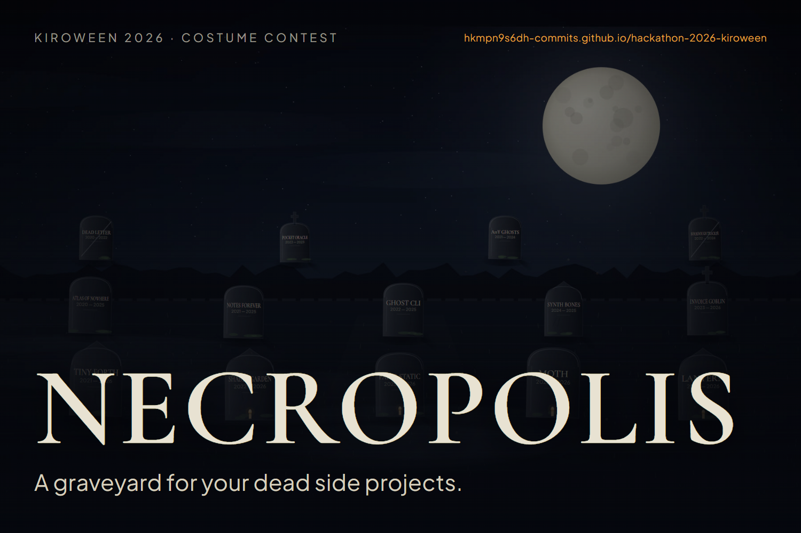

# Necropolis

**A graveyard for your dead side projects.**

Enter a GitHub handle. Necropolis lays out every public repository as a tombstone in a night graveyard — the oldest buried furthest back — then performs an autopsy on each one: how long it has been gone, what killed it, and whether it deserves to be raised again.

Built for **Kiroween 2026 — Costume Contest**.

- **Live app**: https://hkmpn9s6dh-commits.github.io/hackathon-2026-kiroween/
- **Kiro write-up**: [KIRO.md](KIRO.md)
- **Spec**: [docs/01-SPEC.md](docs/01-SPEC.md) · **UI**: [docs/07-UI.md](docs/07-UI.md) · **Rules brief**: [docs/00-BRIEF.md](docs/00-BRIEF.md)



## What it does

- **Six states** — still breathing, fading, dormant, buried, forgotten, entombed (archived).
- **Autopsy** — cause of death, last sign of life, age, stars, forks, issues, language, size, licence.
- **Revival odds** — a score out of 100 and three concrete steps to raise it, or to let it rest.
- **Obituary** — a downloadable 1200 × 630 card that makes the decision public.
- **Demo graveyard** — a hand-buried sample that works with no network at all.

## Run it

```bash
npm ci
npm run dev      # http://localhost:5173
npm run build    # production build in dist/
npm run verify   # type-check, build, unit checks, repo hygiene
```

Deploy (maintainers): `bash scripts/deploy.sh` builds and pushes `dist/` to the `gh-pages` branch.

## How it works

```
src/
  scene/graveyard.ts   Canvas 2D renderer: sky, moon, ridge, wall, graves, fog, embers, camera
  lib/github.ts        Public GitHub REST + 6-hour localStorage cache + demo fallback
  lib/vitality.ts      Classification, cause of death, revival score, resurrection plan
  lib/obituary.ts      1200×630 share card, drawn on canvas
  components/          Gate, Stage, AutopsyPanel, ObituaryDialog
  styles/              Design tokens + layout
```

- The static background is painted once per resize into an offscreen canvas; the animation loop only redraws fog, embers, candle flames and the camera transform.
- `prefers-reduced-motion` freezes the camera and the flicker.
- Every grave is also a real button in a visually hidden list, so the graveyard is keyboard- and screen-reader-navigable.

## Privacy

- Only public data from `api.github.com`; no OAuth, no private repositories, no write access.
- Nothing is sent to a server we control. The only persistence is a six-hour `localStorage` cache.
- In demo mode the app makes zero network requests.

## Licence

MIT — see [LICENSE](LICENSE).
